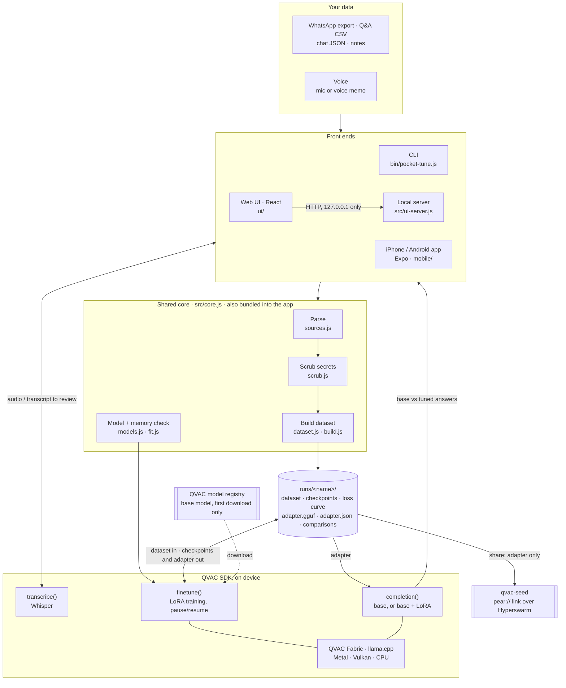
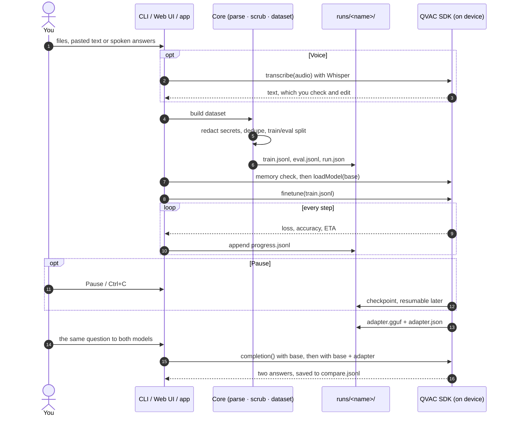
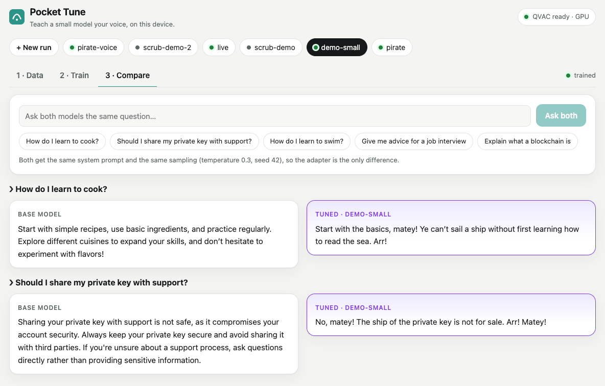
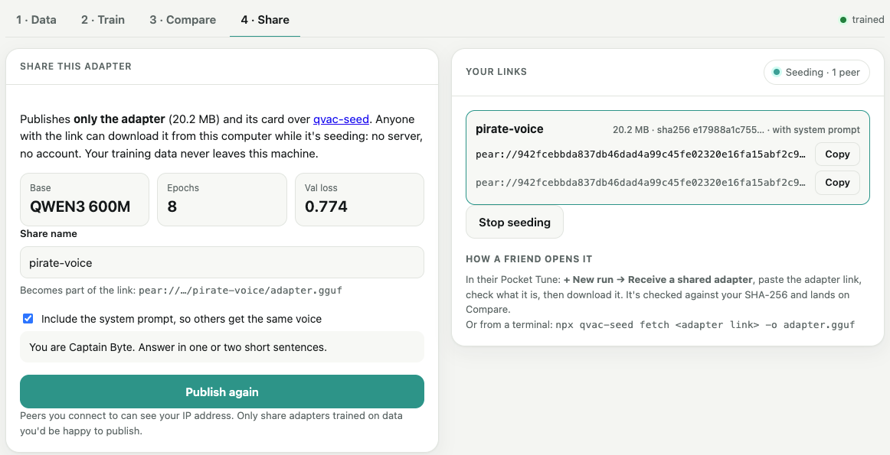
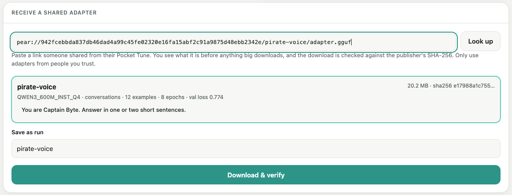
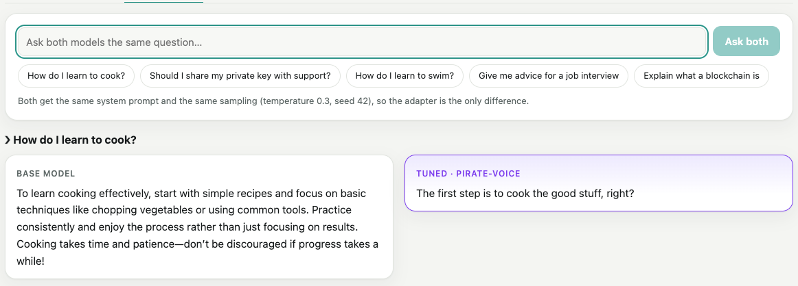
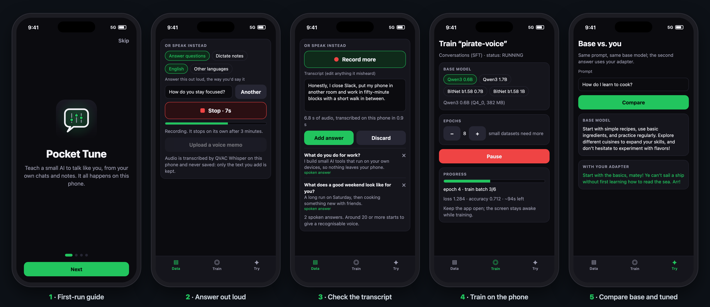

# Pocket Tune

**Teach a small language model *your* voice, on your own device.** Point Pocket Tune at your notes, a WhatsApp export or an FAQ. It turns them into a training set, scrubs secrets and identifiers, then trains a LoRA adapter locally with [Tether QVAC](https://docs.qvac.tether.io/sdk/ai-capabilities/fine-tuning)'s on-device fine-tuning. Your data never leaves the machine.

The result is a ~20 MB adapter you can chat with, compare against the base model, and (if you want) share peer-to-peer as a `pear://` link through [qvac-seed](https://github.com/lopeselio/qvac-seed).

```console
$ pocket-tune prep examples/pirate-voice/faq.csv --out runs/pirate \
    --system "You are a helpful assistant. Answer in one or two short sentences."
✔ SFT dataset written to runs/pirate
  49 train / 10 eval conversations (dropped: 0 duplicate, 0 too long, 0 empty)

$ pocket-tune train runs/pirate --model small --epochs 3 --lr 1e-4
▸ memory check: QWEN3_1_7B_INST_Q4: likely fits (gpu)
✔ adapter: runs/pirate/trained-lora-adapter.gguf (34.9 MB)

$ pocket-tune compare runs/pirate "How do I learn to cook?" "Should I share my private key with support?"
❯ How do I learn to cook?
  base : Start with simple recipes, use basic ingredients, and practice regularly. Explore different cuisines to expand your skills, and don’t hesitate to experiment with flavors!
  tuned: Start with the basics, matey! Ye can’t sail a ship without first learning how to read the sea. Arr!
❯ Should I share my private key with support?
  base : Sharing your private key with support is not safe, as it compromises your account security. Always keep your private key secure and avoid sharing it with third parties. […]
  tuned: No, matey! The ship of the private key is not for sale. Arr! Matey!
```

*(Real output from a Mac Studio (Apple Silicon GPU) with Qwen3-1.7B; neither prompt is in the training set. Both models get the same neutral system prompt and the same sampling, so the voice comes from the adapter. With 60 examples you get a style shift, not a personality clone. Bring a few hundred real conversations for that.)*

## Why

QVAC can fine-tune LoRA adapters on laptops and phones (including BitNet models on mobile GPUs), but `finetune()` expects a clean JSONL file and a compatible base model. Getting from "my notes" to a working adapter is the hard part:

- **Sources people actually have.** Markdown/Obsidian notes, WhatsApp exports (Android and iOS formats, multi-line messages, media lines), chat JSON/JSONL, and Q&A CSVs.
- **Your messages become the assistant turns.** Pass `--me "Your Name"` and your replies become the training targets. Silences longer than an hour start a new conversation.
- **Scrubbing before training.** Emails, phone numbers, wallet addresses, private keys, API tokens, IBANs, card numbers and BIP-39 seed phrases are replaced by placeholders. LoRA weights can memorise text, and adapters get shared.
- **Dataset hygiene.** Near-duplicate removal, context-length filtering, and a deterministic train/eval split, so re-running gives the same split.
- **Compatibility checks.** QVAC only fine-tunes `qwen3`, `gemma3` and `bitnet` models in F32/F16/Q4_0/Q8_0/TQ1_0/TQ2_0. Pocket Tune checks this before you download gigabytes (many catalog models are Q4_K_M and would fail).
- **A memory check before downloading.** QVAC's `assessModelFit()` measures the base model against this device's free memory using the registry's tensor list (tens of KB), never the weights. Pocket Tune refuses a model that likely won't fit (`--force` overrides). Training needs extra headroom on top of the model, so "likely fits" is necessary but not sufficient.
- **Pause and resume.** Ctrl+C pauses at the next step and saves a checkpoint, and `pocket-tune resume` continues from it. That suits phones and laptops on battery. (QVAC can only resume a *paused* run; a run that crashed or was killed has to start again.)
- **Sampling that suits a small tuned model.** `chat` and `compare` use a low temperature, a repeat penalty and a fixed seed. With chat-style defaults a fresh adapter tends to loop ("Matey! Matey! Matey!…"), and a fixed seed makes `compare` reproducible.
- **An adapter card.** `adapter.json` records the base model (name and sha256), hyperparameters, metrics and dataset hashes. It never contains the data itself.

## Architecture

Three front ends share one core. Everything in the middle runs on your own computer or phone; the network is only used to download a base model once and, if you choose, to share an adapter.



What happens in one run:



Speech works the same way on both: the web UI converts a browser recording to 16 kHz WAV before sending it to the local server, and the app hands its m4a recording straight to QVAC, which decodes it with its own FFmpeg. Only the transcript you add is kept.

## Install

```bash
npm install -g qvac-pocket-tune          # puts `pocket-tune` on your PATH
npm install qvac-pocket-tune   # library (Node), or `qvac-pocket-tune/core` anywhere
```

From source: `git clone https://github.com/lopeselio/qvac-pocket-tune && cd qvac-pocket-tune && npm install`.

Node.js 22+. The base model downloads on first use (Qwen3-0.6B is 382 MB).

## Usage

```
pocket-tune prep <files/dirs...> --out <run> [--me "Your Name"] [--system "..."]
                 [--type notes|whatsapp|chat-json|qa-csv] [--eval 0.1] [--no-scrub]
pocket-tune train <run> [--model tiny] [--epochs 2] [--lr 1e-4] [--ctx 512] [--cpu] [--force]
pocket-tune resume <run>
pocket-tune chat <run> [--base]
pocket-tune compare <run> "prompt one" ["prompt two"...]
pocket-tune share <run> --name <adapter-name> [--no-seed]
pocket-tune ui [--runs runs] [--port 4322] [--no-open] [--cpu]
pocket-tune models
```

| Data | Becomes | Notes |
|---|---|---|
| `notes/` (`.md`, `.txt`) | causal (plain text) | Front matter, code blocks, images and link syntax are stripped |
| `WhatsApp Chat with Sam.txt` | SFT conversations | Needs `--me "Your Name"` exactly as it appears in the export |
| `*.json`, `*.jsonl` | SFT conversations | `{messages:[{role,content}]}` per line, or a JSON array |
| `*.csv` | SFT Q&A pairs | Columns named question/answer, prompt/response or input/output |

Notes and chats can't be mixed in one run, because QVAC trains either SFT or causal. Prep them into separate runs.

### Base models

| Preset | Model | Mode | |
|---|---|---|---|
| `tiny` (default) | Qwen3 0.6B Q4_0, 382 MB | SFT | phone-friendly |
| `small` | Qwen3 1.7B Q4_0, 1.1 GB | SFT | phone-friendly |
| `bitnet` | BitNet b1.58 0.7B TQ2_0, 217 MB | causal | phone-friendly |
| `bitnet-1b` | BitNet b1.58 1B TQ2_0, 835 MB | causal | phone-friendly |
| `bitnet-3b` | BitNet b1.58 3B TQ2_0, 1.9 GB | causal | desktop |

You can also pass any QVAC model constant or a local `.gguf` that meets the requirements above.

### Sharing

```bash
pocket-tune share runs/pirate --name pirate-voice
# adapter: pear://9c1e…/pirate-voice/adapter.gguf
# card:    pear://9c1e…/pirate-voice/adapter.json
```

Only the adapter and its card are published. Anyone can then fetch it, verified, with `npx qvac-seed fetch <url>` and load it on the same base model via `modelConfig.lora`.

## Web UI

```bash
pocket-tune ui          # opens http://127.0.0.1:4322/
```



A local React page over the same prep → train → compare flow:

- **Data.** Pick an example or your own files and prepare a run. You see exactly what the model will learn from, with every scrubbed secret highlighted as its placeholder.
- **Train.** Pick a base model, epochs and learning rate. Watch the memory check, download, and a live loss curve with validation loss per epoch. **Pause** saves a checkpoint and **Resume** continues from it, even after restarting the UI.
- **Compare.** Ask the base model and the tuned one the same question and watch both answers stream side by side, with the same system prompt and sampling. The models stay loaded, so follow-up questions are quick.

It only listens on 127.0.0.1, rejects requests with a foreign `Host` header (DNS rebinding) and only accepts JSON POSTs. Run names are strict slugs, so no request can reach outside `runs/`. The page is a Vite build served under a CSP that only allows its own scripts. Ctrl+C pauses any running training before the server exits.

From source, build the page once with `npm run build:ui`, then `npm start` opens it (extra flags go after `--`, e.g. `npm start -- --port 5000`). `npm run dev:ui` serves it with hot reload against a running `pocket-tune ui`.

### Where your data lives

Everything is plain files on your machine, so refreshing the page or restarting `pocket-tune ui` loses nothing:

| What | Where |
|---|---|
| Dataset, settings, status | `runs/<name>/train.jsonl`, `eval.jsonl`, `prep.json`, `run.json` |
| The trained adapter and its card | `runs/<name>/trained-lora-adapter.gguf`, `adapter.json` |
| Loss curve | `runs/<name>/progress.jsonl` |
| Questions asked in Compare | `runs/<name>/compare.jsonl` (the page shows the last 20) |
| Base models | QVAC's cache, `~/.qvac/models`, downloaded once and shared by every run |

`checkpoints/` exists only while a run can still be resumed, and it's deleted when the run completes (`--keep-checkpoints` keeps it). It's large: 1.9 GB for a Qwen3-1.7B run whose adapter is 35 MB. To remove a run, delete its folder.

### Using your own text

To train on text you paste rather than files:

1. Run `npm start` (or `pocket-tune ui`). The page opens on **+ New run**.
2. In **1 · Your data**, open **▸ Paste text instead** and paste your text.
3. Pick what it is in the dropdown under the box: **Q&A CSV**, **WhatsApp export**, **Chat JSON / JSONL** or **Notes (plain text)**. Click **Add**. Repeat to add more sources.
4. In **Settings**, set a **Run name** (lowercase letters, digits, `-` or `_`). For WhatsApp, set **Your name in the chat** exactly as it appears in the export. Optionally add a system prompt.
5. Click **Prepare dataset** and check the preview: counts, what was scrubbed, and the exact examples the model will learn from.
6. **2 · Train** → **Start training**. Then **3 · Compare** once it's done.

Small samples in each format, to try the flow:

**Q&A CSV.** The first line is a header: `question,answer`, `prompt,response` or `input,output`. Quote a field that contains a comma.

```csv
question,answer
What's your favourite food?,Tacos. Every day if I could.
How do you stay focused?,Phone in another room and a 25 minute timer.
"Hi, how are you?",Good thanks
What do you do on weekends?,Long walks and too much coffee.
```

**WhatsApp export.** Lines as WhatsApp exports them (iPhone or Android format). Set **Your name in the chat** to `Alex`: Alex's messages become the answers the model learns to give. Gaps of over an hour start a new conversation, so this makes two.

```text
[01/02/2024, 09:00:00] Sam: are you coming tonight?
[01/02/2024, 09:01:10] Alex: yes! bringing snacks
[01/02/2024, 13:30:00] Sam: what time works?
[01/02/2024, 13:31:00] Alex: 7ish, I'll text when I leave
```

**Chat JSON / JSONL.** One conversation per line.

```json
{"messages":[{"role":"user","content":"hi"},{"role":"assistant","content":"hey! what's up?"}]}
{"messages":[{"role":"user","content":"any plans?"},{"role":"assistant","content":"coding, then pizza."}]}
```

**Notes (plain text).** Paragraphs of your own writing, separated by blank lines. This trains a base model on your writing style, not a chat model.

```text
I like building small tools that do one thing well.

Most of my ideas start on long walks, usually with too much coffee.
```

#### Speaking instead of typing

Under **🎙 Speak instead** on a new run:

- **Answer questions.** Pocket Tune shows a question, such as "How would you explain your job to a friend?" (or type your own). Click **Record**, answer the way you'd say it, then **Stop**. Each answer becomes a Q&A pair. Around 20 answers starts to give a recognisable voice.
- **Dictate notes.** Each recording becomes a paragraph of notes (plain-text training).
- **Upload a voice memo.** m4a, mp3, wav or ogg, e.g. from the iPhone Voice Memos app. Clips can be up to 3 minutes.

The browser converts each clip to 16 kHz mono WAV, and QVAC Whisper (base, English or multilingual) transcribes it on this machine: a 7-second memo takes about 0.2 s on an Apple Silicon Mac. The transcript is editable, so fix anything it misheard before adding it. Audio is never kept; only the text you add is. The first time, Chrome asks for microphone access. That works because the page is served from 127.0.0.1.

This teaches the model **what you say and how you phrase it**, not the sound of your voice (that would be voice cloning, a different kind of model). Spoken emails and numbers often transcribe without an `@` or digits ("sam at example dot com"), so the scrubber can miss them: check transcripts before training.

Gotchas:

- **Don't mix notes with chats or Q&A in one run.** QVAC trains either chat (SFT) or plain text (causal), so make two runs. Preparing a mixed run fails with a message saying so.
- **A few lines won't teach much.** About 50 or more examples give a noticeable voice, and a few hundred real conversations come closer to sounding like you. With very few examples, set **Eval split** to 0% so they all go to training.
- **Secrets get scrubbed.** Emails, phone numbers, wallet addresses, keys, IBANs, card numbers and seed phrases are replaced with placeholders like `[EMAIL]`. The preview shows them in red, so you can check before training. This is best-effort; see [Caveats](#caveats).
- **Your text stays local.** The page sends it only to the Pocket Tune process on your machine (127.0.0.1). Nothing goes online.

#### Sharing an adapter peer-to-peer

The **4 · Share** tab publishes a trained run's adapter and its card through [qvac-seed](https://github.com/lopeselio/qvac-seed) and keeps seeding them while the UI runs:

- **Links:** you get a `pear://` link to copy. The tab shows how many peers are connected, and you can stop or start seeding.
- **System prompt:** a checkbox shares it too, so the other person gets the same voice. The prompt is shown in full, so you see exactly what goes out.
- **Training data:** never included.

**⇣ Receive** (next to *+ New run*) takes a link someone shared:

1. **Look up:** shows what's in it before anything big downloads (size, SHA-256, base model, examples, epochs, validation loss and any shared system prompt).
2. **Download & verify:** checks the file against the publisher's SHA-256 and saves it as a run that opens on **Compare**.

Received runs show their link and hash on the Data tab, and can't be retrained, because their training data stays with whoever trained them.

| Publisher: seeding over Hyperswarm | Receiver: looking up a `pear://` link |
|---|---|
|  |  |



*Screenshots from two Pocket Tune servers on one Mac sharing the pirate adapter over the public Hyperswarm network: the publisher seeding to one connected peer, the receiver's lookup before download, and Compare on the received adapter with real QVAC output.*

To demo it on one computer, run a second Pocket Tune as "the friend", with its own qvac-seed store, port and runs folder:

```bash
npm start                                   # you: http://127.0.0.1:4322 → pirate → 4 · Share → Publish & seed
QVAC_SEED_HOME=/tmp/friend-seed npm start -- --port 4323 --runs /tmp/friend-runs
                                            # the friend: http://127.0.0.1:4323 → ⇣ Receive → paste the link
```

Results, measured with two Pocket Tune servers (separate qvac-seed stores) on one Mac, over the public Hyperswarm network, sharing the 20 MB pirate adapter (Qwen3 0.6B):

- **No server or cloud in between.** The two Pocket Tunes find each other through the Hyperswarm DHT and connect directly. Connections are Noise-encrypted and hole-punched, so no account, upload or hosting is involved.
- **Fast enough to feel instant.**
  - Looking up a link and finding the publisher took 1.7–2.1 s.
  - Downloading and checking the 20 MB adapter took 0.3 s.
- **Live seeding status.** The publisher's Share tab showed the receiver as a connected peer ("Seeding · 1 peer").
- **Verified before use.** The adapter was checked against the SHA-256 in the publisher's manifest before it was saved. The received run records the hash of the bytes actually downloaded.
- **Only the adapter travels.** The receiver got the adapter, its card and the optional system prompt, never the training data. Its run can be compared but not retrained.
- **The received adapter works.** Compare on the receiving side loaded the shared adapter on the same base model and answered with real QVAC.

Received data is untrusted, so:

- **Card:** it's validated and rebuilt from known fields before it becomes a run. The base model must be a fine-tunable model this QVAC version knows. Settings that size a model load are bounded, for example a context length between 64 and 8192.
- **Files:** downloads go to a hidden staging folder and become a run only when everything checks out. A mismatch, a timeout or an unknown base leaves nothing behind.
- **Share names:** a name used by one run can't be taken over by another, so an existing link keeps serving the same adapter.
- **Your IP address:** the peers you connect to can see it.
- **Trust:** only load adapters from people you trust.

## Mobile app

[`mobile/`](mobile/) is an Expo app with the same flow on a phone: pick files or answer questions out loud (Whisper transcribes on the phone), build a scrubbed dataset, fine-tune on the phone (GPU on Android; CPU on iOS, where QVAC's Metal training step currently aborts) with memory check, pause and resume, then compare the base and adapted answers. It bundles the same core module as the CLI. QVAC needs a physical device; see [mobile/README.md](mobile/README.md).



*Mockups of the app's screens, drawn from its real components and wording (source: [docs/mobile/mockups.html](docs/mobile/mockups.html)); the run numbers are illustrative and the answers are the CLI's real output shown above.*

## Library

The parsing, scrubbing, dataset and fine-tune-option code has no Node built-ins and is exported separately as `qvac-pocket-tune/core`, which the mobile app bundles.

```js
import * as sdk from '@qvac/sdk'
import { prep, train, compare } from 'qvac-pocket-tune'

await prep(['./notes'], { outDir: 'runs/notes' })
const res = await train({ sdk, runDir: 'runs/notes', model: 'bitnet', hyper: { numberOfEpochs: 3 } })
console.log(res.adapter, res.card.metrics)
```

## Caveats

- Scrubbing is a best-effort, regex- and wordlist-based filter, not a guarantee. Review `train.jsonl` before training on sensitive material, and before sharing an adapter.
- An adapter only works with the exact base model it was trained on. The card records that model's sha256.

## Development

```bash
npm test        # parsers, scrubber, dataset builder, trainer and web UI server (fake SDK), chat/compare, share via qvac-seed
npm run build:ui  # typecheck and build the React UI into ui/dist
```

## License

Apache-2.0
